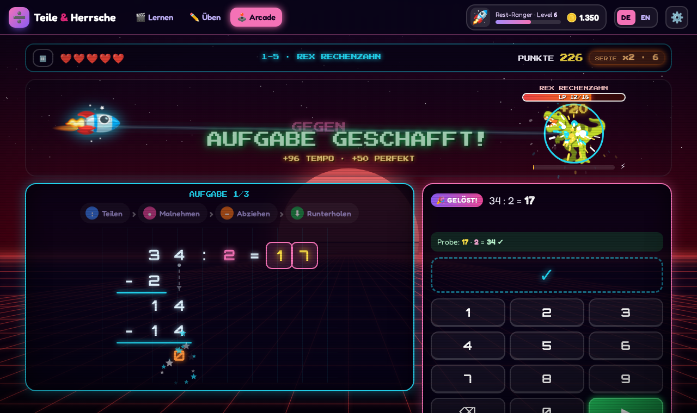
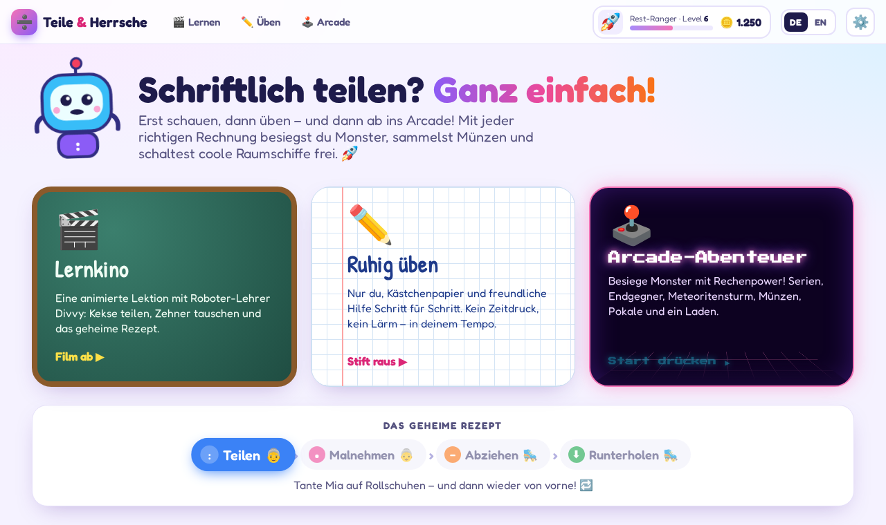
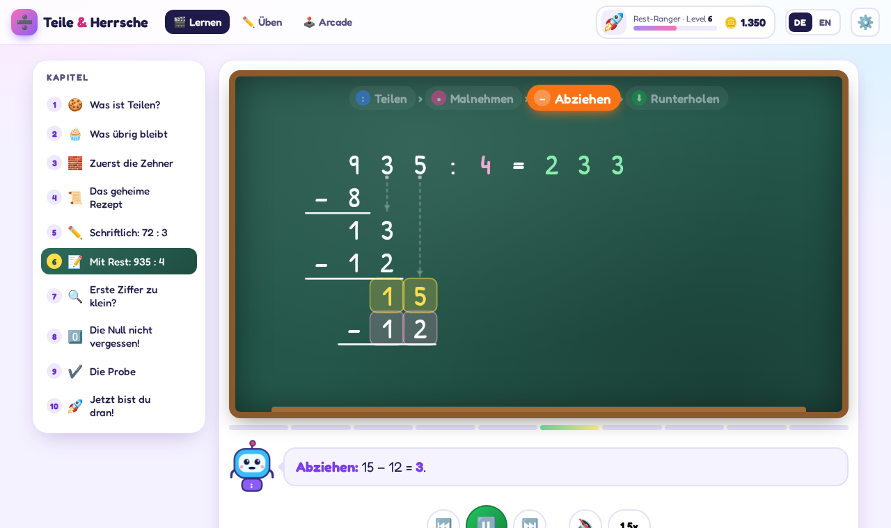
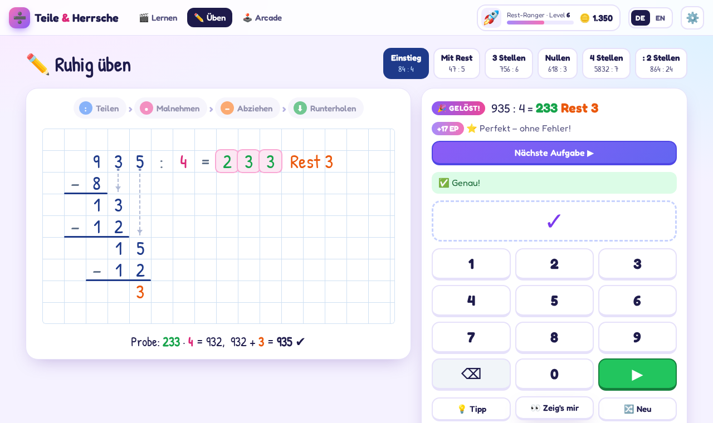
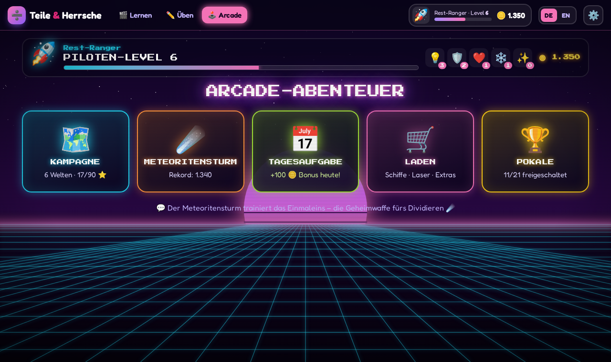
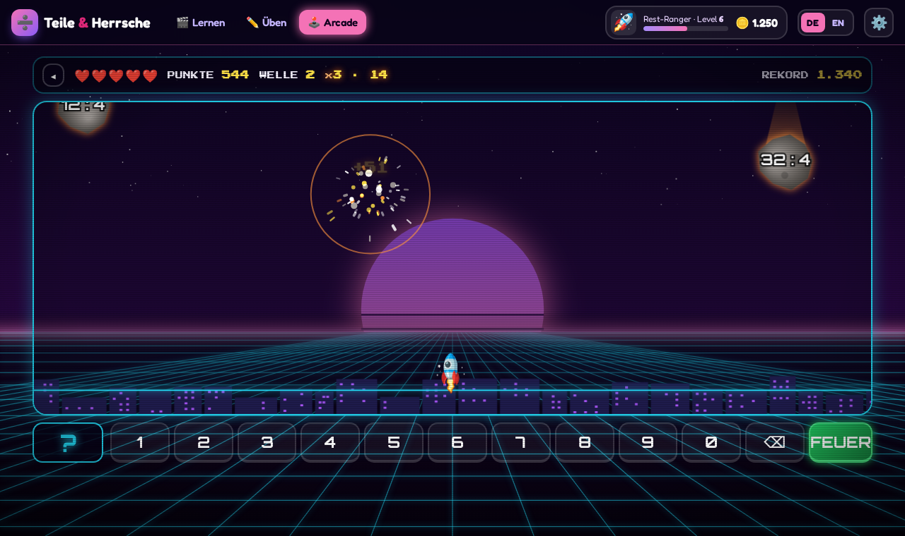

# Divide & Conquer ➗ · Teile & Herrsche

**Long division for kids – learn it, practise it, then blast monsters with it.**
A web app that teaches pupils long division the pen-and-paper way, in **German** (default) and **English**.
No build step and no install: open `index.html` in a browser.

  
   <em>Every correct step fires your laser – solve the division, defeat the boss!</em>

## Screenshots

<table>
  <tr>
    <td width="50%"> <b>Start</b> – three ways to learn, guided by Divvy the robot</td>
    <td width="50%"> <b>Lernkino</b> – an animated, narrated chalkboard lesson</td>
  </tr>
  <tr>
    <td width="50%"> <b>Ruhig üben</b> – step by step on squared paper, with hints and the check (“Probe”)</td>
    <td width="50%"> <b>Arcade</b> – campaign, daily challenge, shop and trophies</td>
  </tr>
  <tr>
    <td colspan="2" align="center"> <b>Meteorsturm</b> – zap falling times-table meteors before they hit Number City</td>
  </tr>
</table>

## Three modes
- **🎬 Lernkino / Watch & Learn**: an animated, narrated chalkboard lesson in 10 chapters (sharing
  cookies, remainders, tens and ones, the 4-step recipe, worked examples, zeros in the answer, the
  check ("Probe")). It can also explain any problem you type in.
- **✏️ Üben / Practice**: calm step-by-step solving on squared paper. Each step gets specific
  feedback and two levels of hints. 6 difficulty levels; you can also type your own problem.
- **🕹️ Arcade**: every correct step fires a laser at a monster. Includes 6 worlds × 5 levels with
  bosses, combos, power-ups, mystery chests, Meteor Storm (times-table shooter), a daily
  challenge, a shop, 21 trophies and XP levels. There is no background music, only short sound
  effects, which can be turned off.

## Language and notation
- German is the default for everyone. Switch with the **DE | EN** button in the top bar or in ⚙️
  Settings; the choice is remembered (and kept in the address as `?lang=en`, so it also works when the
  browser blocks storage). Page addresses follow the language (`#ueben`, `#lernen`).
- `index.html` loads the scripts with a fresh `?v=` on every page load, so the browser can never mix
  old cached files with new ones.
- The default is the German/European style: `935 : 4 = 233 Rest 3`, written in one line with the
  working underneath, `:` for division and `·` for multiplication. The English bracket style
  (`4 ⟌ 935`) can be chosen in ⚙️ Settings.
- German memory aid for the 4 steps: **Tante Mia auf Rollschuhen** (Teilen, Malnehmen, Abziehen,
  Runterholen).
- All texts live in `js/i18n.js`.

Progress is saved in the browser (localStorage). Fonts load from Google Fonts. Everything else,
including sounds, is generated locally. Divvy's mouth only moves while the narrator voice is
actually audible (it follows the browser's speech events word by word).
